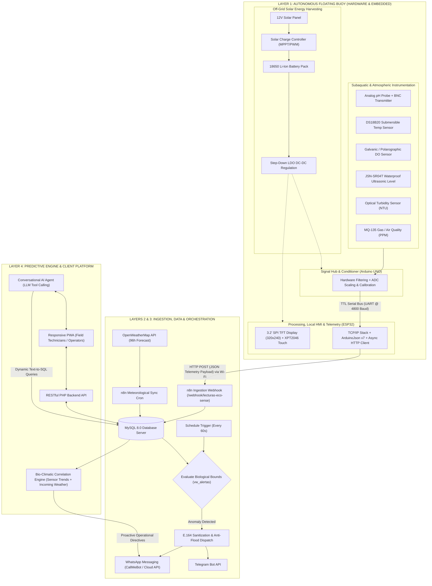
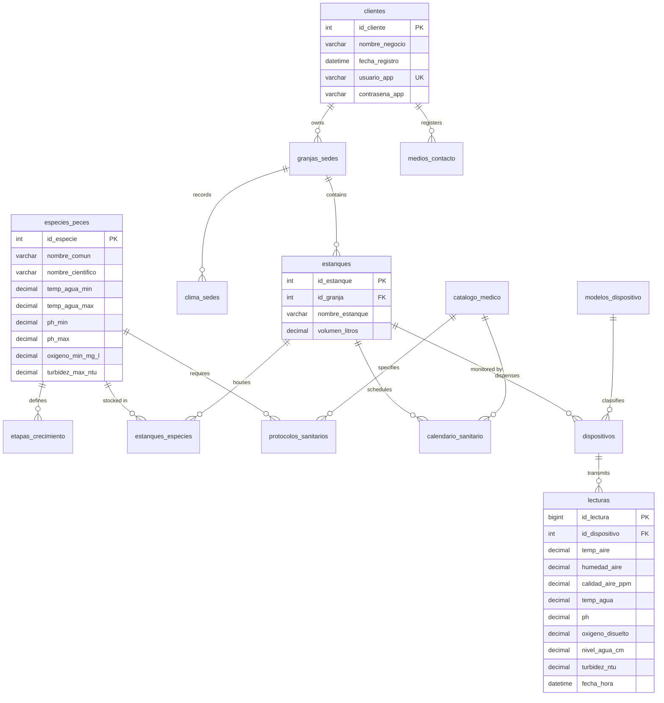

# 🌊 AQÜA-ZENSE — 24/7 IoT Predictive Monitoring & Management System for Aquaculture

<p align="center">
  
  
  
  
  
  
</p>

---

## 📌 Executive Summary

**AQÜA-ZENSE** is an industrial-grade cyber-physical IoT platform engineered for **precision aquaculture** (earthen ponds, geomembrane tanks, and intensive raceway Aquaculture Production Units — APUs/UPAs, primarily cultivating **Tilapia** and **Catfish**).

Its core objective is to **transition commercial fish farming from a traditional reactive posture** (intervening only after mass mortality has already begun) to an **automated, continuous 24/7 predictive and preventive paradigm**. By cross-correlating real-time subaquatic water metrics, ambient microclimatic conditions, and 96-hour extended weather forecasts, the system anticipates critical hypoxia, anoxia, thermal stress, and ammonia toxicity events. It dispatches immediate actionable alerts directly to farm managers and generates operational guidelines before biological collapse can occur.

> 🏆 **Project Milestones & Scientific Research:**  
> Developed as **Embedded Systems and IoT Lead**, qualified for the regional stage of **InnovaTecNM 2026**, and serving as the foundation for a scientific paper accepted for oral presentation at the **2nd International Congress on Multidisciplinary Approaches in Agricultural Sciences (ASMAC 2026)** at **Bayburt University, Turkiye**.

---

## 🎖️ Scientific Publication & Academic Recognition

* **InnovaTecNM 2026:** Developed as **Embedded Systems and IoT Lead**, officially qualified for the **Regional Stage** of the National Student Innovation and Technology Contest (*InnovaTecNM 2026*).
* **ASMAC 2026 (Bayburt University, Turkiye):** Serving as the technical, architectural, and empirical foundation for a peer-reviewed scientific research paper accepted for **oral presentation** at the **2nd International Congress on Multidisciplinary Approaches in Agricultural Sciences (ASMAC 2026)** hosted at Bayburt University, Turkiye.

---

## 🎯 Engineering Objectives & Demonstrated Skills

This project was architected end-to-end to showcase comprehensive, full-stack engineering proficiency across hardware, software, and data domains:

| Technical Domain | Competencies & Demonstrated Engineering Skills |
| :--- | :--- |
| **Embedded Systems & Firmware** | Dual-MCU architecture (Arduino UNO + ESP32), high-impedance analog signal conditioning, asynchronous UART serial bus with fault-tolerant parsing, Non-Volatile Storage (NVS) fallback management, custom flash memory partition schemes (`Huge APP` 3MB No OTA / 1MB SPIFFS), and real-time color TFT GUIs (`TFT_eSPI` + `XPT2046` touch controller). |
| **Electronic Design & Power Systems** | Off-grid solar photovoltaic (PV) power harvesting, lithium-ion 18650 multi-cell management with protection circuits, MPPT/PWM solar charge regulation, and electromagnetic noise decoupling for sensitive electrochemical sensors (pH and Dissolved Oxygen). |
| **Mechanical & Marine Engineering** | Hydrodynamic nautical buoy design featuring a high-buoyancy closed-cell Expanded Polystyrene (EPS) core, encapsulated within multi-layer fiberglass lamination and UV/salinity/corrosion-resistant marine polyester/epoxy resin. |
| **Data Infrastructure & Backend** | Third Normal Form (3NF) relational database design, composite indexing optimized for high-frequency time-series telemetry, automated MySQL event triggers, Docker containerization, and enterprise workflow orchestration pipelines using n8n. |
| **Artificial Intelligence & NLP** | Large Language Model (LLM) integration via Tool Calling / Function Calling for secure real-time Text-to-SQL natural language translation over normalized schemas, along with bio-climatic predictive matrix correlation algorithms. |
| **Web & Cloud Development** | Progressive Web App (PWA) architecture with Service Workers for offline caching and field operation, responsive dark-mode UI/UX design, parameterized RESTful PHP APIs with SQL-injection prevention, and Nginx reverse proxying on Alpine Linux containers. |

---

## 🏛️ General System Architecture

The **AQÜA-ZENSE** ecosystem is structured across four tightly integrated architectural layers:



---

## 🌊 The Four Core Pillars of the Project

### 1. Hardware Architecture: Autonomous Floating Marine Buoy

The marine buoy functions as a self-sustaining, edge-computing sensory node designed to withstand demanding environmental conditions in remote aquatic bodies.

#### A. Sensing Layer & Signal Conditioning Hub (Arduino UNO)
A dedicated microprocessing unit exclusively tasked with the acquisition, analog conditioning, and digital filtering of high-impedance underwater sensors:
- **Industrial Grade pH Probe with BNC Interface:** Paired with an analog signal converter module equipped with multi-turn trimpots for offset and gain calibration.
- **Submersible Dallas DS18B20 Temperature Sensor:** Encapsulated in 316 stainless steel housing with a chemical- and algae-resistant silicone cable over a 1-Wire digital bus.
- **Dissolved Oxygen (DO) Sensor:** Galvanic/polarographic industrial probe for continuous monitoring of dissolved oxygen concentration in $\text{mg/L}$.
- **JSN-SR04T Waterproof Ultrasonic Level Sensor:** Hermetically sealed IP67 piezoelectric transducer with shielded cabling, measuring pond freeboard and water levels without surface bounce distortion.
- **Optical Turbidity Sensor:** Measures light attenuation across suspended solids using an infrared emitter and phototransistor, scaled to Nephelometric Turbidity Units (NTU).
- **MQ-135 Air Quality & Ambient Gas Sensor:** Continuously monitors atmospheric hydrogen sulfide ($H_2S$), ammonia ($NH_3$), and decomposition vapors originating from surface sludge.

#### B. Processing, Local HMI & Telemetry Engine (ESP32)
- **ESP32 Dual-Core Tensilica Xtensa LX6 @ 240 MHz:** Simultaneously drives graphics rendering, JSON serialization, background Wi-Fi management, and non-blocking HTTP networking.
- **Full-Color HMI Touchscreen (320x240 TFT SPI + XPT2046 Resistive Touch):** Managed by the high-performance `TFT_eSPI` library via a finite-state machine (FSM) presenting:
  - Main operational dashboard with network-synchronized time and local weather.
  - Dynamic battery fuel gauge and charge percentage indicator.
  - Dedicated full-screen diagnostics for each of the 6 sensors with nominal threshold markers.
  - 18-hour interpolated historical telemetry trend charts rendered on-screen.
  - Setup screen with hardware-driven PWM backlight dimming and Wi-Fi credential portal.
- **Inter-MCU Communication Bus (UART TTL):** Asynchronous protocol transmitting structured comma-delimited strings:
  ```text
  DATA,TempAire,pH,Gas,TempAgua,NivelAgua,TurbidezVolt\n
  ```
  The parser incorporates non-blocking timeouts ($50\text{ ms}$) and substring search (`indexOf("DATA,")`) to discard transient line noise and prevent MCU stalls.
- **Partition Scheme Optimization:** Configured under `Huge APP (3MB No OTA / 1MB SPIFFS)` to provide sufficient program space for TLS crypto suites, graphic font arrays, and memory pools without heap fragmentation.

#### C. Power Management & Naval Mechanical Enclosure
- **Li-Ion 18650 Battery Array:** High-capacity cells coupled with an integrated Battery Management System (BMS) for undervoltage, overcharge, and short-circuit protection.
- **Solar MPPT/PWM Harvesting:** Top-mounted 12V monocrystalline/polycrystalline photovoltaic solar panel providing continuous off-grid energy replenishment.
- **Hydrodynamic Hull (EPS + Laminated Fiberglass):** CNC-machined closed-cell expanded polystyrene core ensuring positive reserve buoyancy, coated with laminated fiberglass cloth and marine-grade epoxy resin resistant to UV radiation, biofilm adhesion, and mechanical impact.

---

### 2. Data Infrastructure & Backend (n8n + Docker + MySQL)

Telemetry is processed through a high-throughput, containerized Linux pipeline:

#### Ingestion Pipeline
The ESP32 issues structured `HTTP POST` requests serialized with **ArduinoJson v7**:

```json
{
  "id_dispositivo": 1,
  "temp_aire": 28.50,
  "ph": 7.42,
  "calidad_aire_ppm": 412.10,
  "temp_agua": 27.80,
  "nivel_agua_cm": 115.40,
  "turbidez_volt": 3.82
}
```

The **n8n** webhook endpoint (`/webhook/lecturas-eco-sense`) validates incoming payloads, normalizes metrics, and executes parameterized insertions into the `lecturas` table in MySQL.

#### Relational Data Model (3NF)

The schema is rigorously divided into 4 decoupled functional domains connected through a central pond entity:

```
+-------------------------------------------------------------------------------------------------+
|                                     RELATIONAL DATABASE SCHEMA                                  |
+-------------------------------------------------------------------------------------------------+
|  [CUSTOMER DOMAIN]             [BIOLOGICAL / APU DOMAIN]             [MEDICAL DOMAIN]           |
|  clientes                      especies_peces                        catalogo_medico            |
|    ├── granjas_sedes             ├── etapas_crecimiento                ├── protocolos_sanitarios|
|    │     └── estanques <───────┼── estanques_especies                  └── calendario_sanitario |
|    ├── clima_sedes               │                                                              |
|    └── medios_contacto           ▼                                                              |
|                           [HARDWARE / IOT DOMAIN]                                               |
|                           modelos_dispositivo ──► dispositivos ──► lecturas                     |
+-------------------------------------------------------------------------------------------------+
```

#### Entity-Relationship Diagram (ERD)



#### Autonomous Biological Threshold & Alerting Engine
- An **n8n Schedule Trigger** queries the `vw_alertas_parametros_fuera_rango` relational view every **60 seconds**.
- The engine executes multi-table joins comparing real-time telemetry against species-specific physiological thresholds:
  - **Tilapia / Catfish — Water Temperature:** Safe zone $26.0^\circ\text{C} - 30.0^\circ\text{C}$.
  - **Hydrogen Potential (pH):** Strict tolerance between $6.5 - 8.5$. At elevated water temperatures, a $\text{pH} > 8.5$ shifts non-toxic ammonium ions ($NH_4^+$) into lethal unionized free ammonia ($NH_3$). A $\text{pH} < 6.5$ induces severe branchial acid burns and osmoregulatory failure.
  - **Dissolved Oxygen (DO):** Critical baseline set at $5.0\text{ mg/L}$. Readings below $3.0\text{ mg/L}$ immediately trigger priority red alarms for acute hypoxia risk.
- **Anti-Flood Filtering & E.164 Sanitization:** An evaluation window `fecha_lectura >= NOW() - INTERVAL 1 MINUTE` prevents message duplication, sanitizes phone numbers into international E.164 formatting, and dispatches automated diagnostics via WhatsApp and Telegram bots.

---

### 3. Predictive Intelligence & Bio-Climatic Correlation

Unlike passive alarm systems, **AQÜA-ZENSE** correlates biological trends with upcoming atmospheric changes:

1. **Continuous Meteorological Synchronization:** Automatically polls the OpenWeatherMap API (5-day forecast at 3-hour intervals, spanning 96 hours ahead) mapped to farm GPS coordinates (`granjas_sedes.latitud`, `longitud`).
2. **Predictive Matrix Reasoning:**
   - **Nocturnal Anoxia Prevention:** When water sensors record a downward slope in dissolved oxygen while the forecast indicates a **warm, heavily overcast night** (surface photosynthesis ceases while bacterial and phytoplankton respiration skyrockets), the system generates an advance advisory to **schedule mechanical surface aerator activation hours ahead of time**.
   - **Thermal Shock & Overfeeding Mitigation:** Ahead of an approaching **cold front or severe storm**, the engine anticipates the drop in poikilothermic fish metabolism. It instructs farm personnel to **curtail feeding rations**, preventing uneaten pellet feed from accumulating on pond bottoms, fermenting into toxic nitrites, and causing mass suffocation.

---

### 4. AI-Assisted Interface & Progressive Web App (PWA)

#### Conversational Text-to-SQL AI Agent
Integrates Large Language Models (LLMs via OpenAI / Tool Calling in n8n) connected directly to the database metadata schema. Farm managers and field technicians can interact via natural voice or text queries:
> *"Which tilapia pond has the lowest dissolved oxygen right now, and when is the next scheduled anti-parasitic treatment due?"*

The agent formulates a secure, parameterized SQL query, executes it against the MySQL database, and returns a concise, structured response in conversational language.

#### Progressive Web Application (PWA)
- Built with semantic HTML5, modern vanilla CSS (glassmorphism dark UI), and reactive vanilla JavaScript.
- Displays live weather banners, sensor gauges, dynamic historical charts, and full CRUD interfaces for managing ponds, stocking densities, medical catalogs, and sanitary schedules.
- Fully installable on iOS and Android devices via `manifest.json` with offline caching powered by `sw.js` (Service Worker).

---

## 🛠️ Complete Technology Stack

```
HARDWARE & EMBEDDED SYSTEMS:
├── Microcontrollers: ESP32 Dual-Core (Xtensa LX6 @ 240MHz), Arduino UNO
├── HMI & Display: 2.8" / 3.2" SPI TFT (320x240), ILI9341 Driver, XPT2046 Resistive Touch
├── Sensor Array: DS18B20 (Submersible Temp), Industrial Analog pH Kit (BNC),
│                 Galvanic Dissolved Oxygen (DO), JSN-SR04T (Waterproof Ultrasonic Level),
│                 Optical Turbidity Sensor (NTU), MQ-135 (Air Quality / PPM)
├── Power System: 12V Mono/Polycrystalline Solar Panel, MPPT/PWM Solar Regulator, 18650 Li-Ion Cells
└── Mechanical Enclosure: Hydrodynamic EPS core wrapped in multi-layer fiberglass & marine epoxy

FIRMWARE & PROTOCOLS:
├── C++ / Arduino Framework
├── TFT_eSPI & LovyanGFX
├── ArduinoJson v7 (Dynamic heap management with JsonDocument)
├── Buses: Asynchronous UART TTL Inter-MCU, SPI (Display & Touch), 1-Wire (DS18B20)
└── Connectivity: Wi-Fi 802.11 b/g/n, Async HTTPClient, Bluetooth Serial

DATA INFRASTRUCTURE & BACKEND:
├── Docker & Docker Compose
├── n8n Workflow Automation (Webhooks, Schedule Triggers, Telegram & WhatsApp Nodes)
├── MySQL 8.0 (Relational schema, triggers, stored views, composite indexing)
└── External APIs: OpenWeatherMap (5-Day / 3-Hour Forecast), Reverse GeoIP

CLIENT SOFTWARE & AI:
├── Frontend: Semantic HTML5, Vanilla CSS3 (Glassmorphism), Modern JavaScript ES6+
├── PWA Capabilities: Web App Manifest, Service Workers (sw.js) for offline caching
├── Backend API: PHP 8.x with Prepared Statements against SQL injection
├── Web Server: High-performance Nginx running on Alpine Linux container
└── AI & NLP: OpenAI API / LangChain / Tool Calling over relational schemas
```

---

## 📂 Repository Directory Structure

```bash
AQUA-SENSE/
├── APP WEB/                          # Progressive Web App (PWA) & Backend API
│   ├── conn.php                      # RESTful PHP API (CRUD, auth, cascading farm telemetry)
│   ├── index.html                    # Main responsive dashboard (monitoring, weather, ponds)
│   ├── manifest.json                 # Web App Manifest for mobile installation
│   ├── query de la bd.sql            # Full MySQL DDL script (tables, indexes, triggers)
│   ├── script.js                     # Reactive UI state logic, sensor polling & dynamic charts
│   ├── style.css                     # Design system, glassmorphism theme & responsive layouts
│   └── sw.js                         # Service Worker for offline asset caching
│
├── EcoSense_Fish/                    # C++ Embedded Firmware for ESP32 (HMI & Telemetry)
│   ├── EcoSense_Fish.ino             # Main sketch: setup, state machine, and serial parsing
│   ├── ClimaAPI.h                    # HTTP client for OpenWeatherMap forecasts & GeoIP
│   ├── ControlBateria.h              # Battery charge calculation and graphical fuel gauge
│   ├── LGFX_Config.h                 # SPI bus and display configuration parameters
│   ├── PantallaAjustes.h             # Configuration menu and PWM backlight control
│   ├── PantallaCalendario.h          # On-screen sanitary prophylaxis calendar display
│   ├── PantallaDetalleSensores.h     # Individual sensor diagnostic views with safety bounds
│   ├── PantallaGrafica.h             # Real-time on-screen historical trend line rendering
│   ├── PantallaPrincipal.h           # Main dashboard with real-time weather and time sync
│   ├── PantallaSensores.h            # Comprehensive 6-sensor real-time telemetry screen
│   ├── PantallaSplash.h              # Animated graphical startup splash screen
│   ├── RelojAPI.h                    # Network Time Protocol (NTP) / API clock synchronization
│   ├── SubidaDatosAPI.h              # Telemetry JSON packaging & transmission to n8n
│   └── WiFi_Connection.h             # Wi-Fi credentials manager and auto-reconnect engine
│
├── GITHUB APP-LandingPage/           # Project Promotional & Showcase Landing Page
│   ├── Dockerfile                    # Container definition for Nginx static deployment
│   ├── nginx.conf                    # Production-ready Nginx static web server configuration
│   ├── index.html                    # Public product landing page
│   ├── script.js                     # UI animations and interaction handling
│   └── style.css                     # Landing page styling and typography
│
└── README.md                         # Master technical documentation
```

---

## 🔬 Commercial Aquaculture Biological Tolerances

The decision engine benchmarks incoming water parameters against established physiological limits for commercial **Oreochromis niloticus** (Nile Tilapia) and **Ictalurus punctatus** (Channel Catfish):

| Water Quality Parameter | Optimal Range | Critical Threshold / Alert | Physiological Impact on Cultured Fish |
| :--- | :---: | :---: | :--- |
| **Water Temperature** | $26.0^\circ\text{C} - 30.0^\circ\text{C}$ | $< 22.0^\circ\text{C}$ or $> 32.0^\circ\text{C}$ | Appetite loss, metabolic depression, or acute thermal shock. |
| **Hydrogen Potential (pH)** | $6.8 - 8.0$ | $< 6.5$ or $> 8.5$ | Acidic branchial burning ($\text{pH} < 6.5$) or lethal free ammonia toxicity ($\text{pH} > 8.5$). |
| **Dissolved Oxygen (DO)** | $5.0 - 8.0\text{ mg/L}$ | $< 3.0\text{ mg/L}$ | Severe hypoxia, surface piping, lethargy, and immediate mass asphyxiation. |
| **Water Turbidity** | $< 30\text{ NTU}$ | $> 50\text{ NTU}$ | Gill fouling, excessive silt sedimentation, or uncontrolled phytoplankton bloom crash. |
| **Ammonia Gases ($NH_3$)** | $< 0.05\text{ ppm}$ | $> 0.20\text{ ppm}$ | Gill tissue necrosis, blood methemoglobinemia, and severe loss of oxygen carrying capacity. |

---

## 👨‍💻 Author & Leadership

* **Lead Engineer:** **Andrei Martínez Bahena**  
* **Role:** Embedded Systems and IoT Lead
* **Project Honors & Research:**
  * **InnovaTecNM 2026:** Regional Stage Qualifier.
  * **ASMAC 2026:** Technical foundation for accepted scientific paper (Oral Presentation at Bayburt University, Turkiye).
* **Core Specializations:** Embedded Systems (C/C++), Industrial IoT Telemetry, Low-Power Naval Instrumentation, Relational Database Modeling & AI Tool Calling.

> 🔒 **Portfolio & Intellectual Property Notice:**  
> This repository is maintained as an engineering portfolio and academic showcase demonstrating technical competencies in cyber-physical IoT architecture, embedded systems, and scientific research. Deployment scripts and commercial execution procedures are intentionally withheld.

---
<p align="center">
  <i>AQÜA-ZENSE — Transforming commercial aquaculture through predictive intelligence and sustainable automation 🐟💧</i>
</p>
